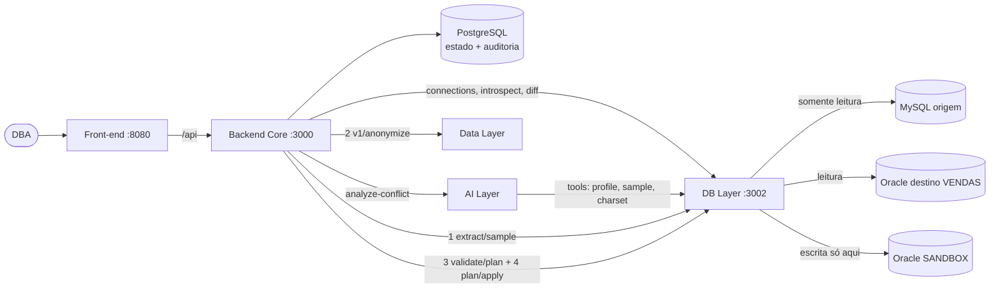

# Placeholder — plataforma de migração MySQL → Oracle (MVP)

O produto não é automatizar a migração: é dar **confiança para migrar**. A maior parte dos
conflitos é mecânica, e código determinístico resolve. A IA só entra onde o dado e o contexto
decidem, e responde **PROPOSE** (com evidência) ou **DEFER** (um humano decide). Nada chega ao
destino sem homologação humana e sem validação num sandbox com dados anonimizados.

Este repositório não tem código de produto: ele **monta a plataforma** a partir do repositório
de cada serviço e roda o teste ponta a ponta.

## Rodando

```bash
docker compose up --build        # primeiro build: ~10-15 min (Rust do Data Layer + Oracle)
```

- **Aplicação:** http://localhost:8080 → **Nova migração**
- **API do Backend Core:** http://localhost:3000
- **DB Layer:** http://localhost:3002

Requisitos: Docker com ~8 GB de memória. A imagem do Oracle roda em Intel e em Apple Silicon.
As portas são publicadas só em `127.0.0.1` (não há autenticação no MVP).

Teste ponta a ponta (com a plataforma no ar, Node 18+, sem `npm install`):

```bash
npm run e2e
```

## Documentação da entrega

| | |
|---|---|
| Mapa da atividade (partes 1–6) | [docs/ENTREGA.md](docs/ENTREGA.md) |
| Arquitetura, crescimento e escalabilidade | [docs/ARQUITETURA.md](docs/ARQUITETURA.md) · [PNG](docs/arquitetura-plataforma.png) |
| Validação técnica | [docs/VALIDACAO_TECNICA.md](docs/VALIDACAO_TECNICA.md) |
| Roadmap | [docs/ROADMAP.md](docs/ROADMAP.md) |
| Teste de usabilidade (roteiro) | [docs/USABILIDADE.md](docs/USABILIDADE.md) |
| Prints do fluxo | [docs/prints/](docs/prints/) |

## Serviços

| Serviço | Repositório | Papel |
|---|---|---|
| Front-end | `pedrolombardi/placeholder-front` | assistente de migração (React), servido por nginx com proxy `/api` → Core |
| Backend Core | `pedrolombardi/placeholder-backend-core` | orquestra o fluxo, máquina de estados, homologação e auditoria (PostgreSQL) |
| DB Layer | `pedrolombardi/placeholder-db-layer` | catálogos, diff classificado, evidências para a IA, extração da amostra, validação no sandbox, script de migração |
| AI Layer | `pedrolombardi/placeholder-ai-layer` | PROPOSE/DEFER com evidência obtida pelas tools do DB Layer |
| Data Layer | `vzio/placeholder-data-layer` | anonimização estatisticamente fiel do sandbox (Rust) |
| Bancos de demonstração | seeds do DB Layer | MySQL 8 (origem, `vendas`, com as cargas de conflito) e Oracle 23ai (destino `VENDAS` + `SANDBOX`) |



## O fluxo (o que a demo mostra)

1. **Análise.** O DB Layer lê os dois catálogos e classifica as 20 colunas: **15 mecânicas**,
   resolvidas por regra, e **5 de julgamento**.
2. **Julgamento da IA.** A AI Layer analisa os conflitos de julgamento com evidência real:
   - `clientes.email` → PROPOSE `VARCHAR2(300 CHAR)` (2 de 10 e-mails acima de 200 bytes, máx. 226);
   - `clientes.ativo` → DEFER (valores 0, 1 e **2**: não é booleano).
3. **Homologação.** O DBA decide cada DEFER e aprova (ou rejeita).
4. **Sandbox anonimizado.** O DB Layer extrai a amostra da origem e o Data Layer anonimiza,
   preservando a distribuição, as FKs e as anomalias (a data zero chega ao sandbox).
5. **Validação.** O DB Layer carrega o dataset nos **tipos planejados** num schema SANDBOX do
   Oracle e verifica, por código determinístico: contagem de linhas, truncamento silencioso,
   integridade das FKs, tipo/precisão/escala e nulos. Um plano que corrompe dados é reprovado.
   Exemplo: manter `VARCHAR2(200)` falha em `silent_truncation`.
6. **Script de migração.** O plano aprovado e validado vira um script para o DBA. Nesta versão,
   nada é escrito no destino.

## Limites conhecidos do MVP

- O DB Layer **gera** o script de migração; executá-lo no destino é um passo do DBA. A execução
  assistida fica para a Fase 7.
- A origem é a configurada no DB Layer (`vendas`). Credenciais por migração ficam para a Fase 7;
  outro banco é recusado (400).
- As regras da AI Layer são determinísticas e calibradas para os conflitos de demonstração. O
  chat com LLM (`/ai/chat`) exige chave de API e não faz parte do fluxo.
- A amostra enviada ao sandbox é limitada a 1.000 linhas por tabela.
- O Core guarda as credenciais da origem em texto no PostgreSQL. As credenciais do compose são
  de demonstração.
