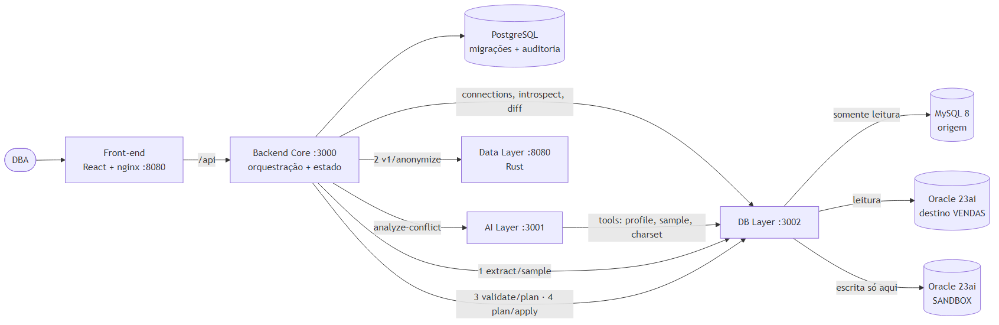
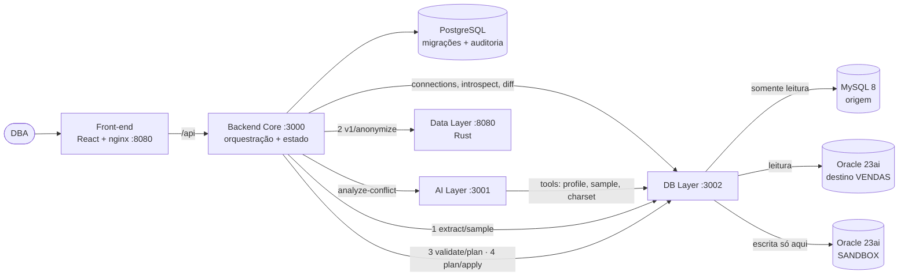

# Arquitetura da plataforma (atualizada após a integração real)

Integração por HTTP/JSON. Cada serviço tem seu repositório, seu Dockerfile e seus testes, e este
repositório monta tudo com um `docker compose up`.

## Decisões tomadas na prática

| Decisão | Por quê |
|---|---|
| O Backend Core é o único que o front-end chama (`/api`, proxy no nginx) | Um ponto de entrada; os layers não ficam expostos ao navegador |
| A IA **nunca** acessa banco: pede evidência às tools do DB Layer só com `{database, table, column}` | A IA escolhe qual evidência quer, nunca como consultar; o DB Layer valida o nome contra o catálogo |
| O DB Layer extrai a amostra e o Data Layer só recebe linhas | O DB Layer é o único com acesso de leitura à origem; o Data Layer não lê nem escreve produção |
| Validação em um schema **SANDBOX** do Oracle, com o dataset anonimizado nos tipos do plano | Compatibilidade de tipos testada no Oracle de verdade, sem tocar a origem nem o destino |
| `/plan/apply` gera o script de migração e não executa | Aplicar em produção é um passo explícito do DBA (execução assistida na Fase 7) |
| Contratos travados por teste nos dois lados + teste ponta a ponta no CI | Os formatos foram combinados durante a integração; um quebrar o outro tem que aparecer no CI |
| Portas publicadas só em `127.0.0.1` | Não há autenticação, e o DB Layer devolve dado pessoal da origem para o anonimizador |

## Como a arquitetura suporta crescimento

- **Novos bancos de origem/destino:** um adaptador novo no DB Layer, que produz o modelo
  normalizado de schema. Core, AI e Data Layer não mudam, porque falam em termos de tabelas,
  colunas e conflitos, não de SQL de um banco.
- **Novas regras de migração:** regras determinísticas no classificador do DB Layer (funções
  puras com teste). Só o que for ambíguo vai para a IA.
- **Novos tipos de evidência:** uma tool nova no DB Layer e sua declaração na AI Layer.
- **Novas telas:** o front consome só a API do Core.

## Escalabilidade

- **Core, AI Layer, Data Layer e a análise do DB Layer não guardam estado** (o estado da
  migração fica no PostgreSQL): podem rodar em N réplicas atrás de um balanceador.
- **O trabalho pesado fica nos bancos:** a análise usa agregações (`COUNT`, `MAX`, `SUM CASE`)
  e trafega números, não linhas. A amostra para o sandbox é limitada (1.000 linhas por tabela).
- **Gargalo conhecido:** a validação é serializada, uma por vez por schema SANDBOX. Para
  paralelizar, a Fase 7 prevê um sandbox por migração.
- **Execução assíncrona:** análise e execução rodam em background no Core (HTTP 202 + consulta
  de status), então requisições longas não seguram conexões do front.

## Manutenção

- **Um repositório por serviço**, com dono, testes e Dockerfile próprios; este repositório só
  orquestra.
- **Testes:** DB Layer 43 (com teste de contrato do Core); Core 17 (com tradução dos contratos
  da IA e do Data Layer); Data Layer com suíte própria; e2e da plataforma no CI, a cada push e
  diariamente.
- **Falhar alto:** erros de qualquer layer chegam ao usuário com a explicação de quem recusou
  (por exemplo, "origem configurada e vendas, nao erp"), e a migração vai a `FAILED` com o motivo.
